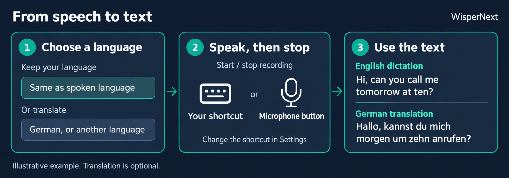

# WisperNext

Free voice typing and speech-to-text for Windows, with optional translation.

WisperNext is open source. It works with Groq's Free Plan for speech
recognition, formatting, and translation, subject to [Groq's usage limits](https://console.groq.com/docs/rate-limits).

Speak naturally and insert text where you're working. Keep the original language
or translate into one of 16 supported languages. Use it for messages, emails,
and other text you would otherwise type.

## Example

| You say | Mode | Example result |
|---|---|---|
| hi can you call me tomorrow at ten | English dictation | Hi, can you call me tomorrow at ten? |
| hi can you call me tomorrow at ten | Translate to German | Hallo, kannst du mich morgen um zehn anrufen? |

These examples illustrate the two modes. Results depend on speech recognition and translation.

## Use it

1. In Settings, choose the spoken language or automatic detection. Set the final
   text language to `Same as spoken language` or a translation language.
2. Place the cursor in a text field. Press your shortcut or click the floating microphone
   button, then speak. Press it again to stop.
3. Paste the result, or enable automatic paste to insert it into the active field.

Right-click the button or use the tray icon to open Settings. The default shortcut
is `F8`; you can change it in Settings. The microphone button also starts and stops recording.

## Features

- Dictation and translation in 16 languages.
- Optional formatting for punctuation, capitalization, and paragraphs.
- A floating microphone button, a configurable global hotkey, and optional automatic paste.
- Automatic or manual microphone selection.
- English, Ukrainian, and Russian interface languages.

Formatting is designed to keep your wording and tone. If optional processing fails
validation, WisperNext keeps the original transcript.
When optional formatting or translation runs, it is also instructed not to add
stock AI, marketing, or bureaucratic phrasing. This does not rewrite expressions
you actually spoke or guarantee that every recognition error will be corrected.

## Install

You need Windows 10 or 11, 64-bit Python 3.12 or 3.13, Git, and a
[Groq API key](https://console.groq.com/keys). The Free Plan is enough to get started;
Groq's limits apply. Windows 11 is the tested platform.
A production installer is not available yet.

[Follow the Windows installation guide](docs/INSTALL_WINDOWS.md).

## Data and privacy

WisperNext needs an internet connection. Audio is sent to Groq for speech recognition;
optional formatting and translation also send the transcript to Groq. The API key
is stored in Windows Credential Manager. Diagnostic logs exclude dictated text,
audio, clipboard contents, and API keys.

## Feedback and development

[Open an issue](https://github.com/teremno/WisperNext/issues) for bugs or feature requests,
or contact [S.O.V (@sovpoker)](https://x.com/sovpoker).
See [CONTRIBUTING.md](CONTRIBUTING.md) to work on the code.

Created by Oleksandr Smuryhin in collaboration with OpenAI Codex.
Licensed under the [MIT License](LICENSE).
